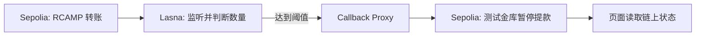

# Ruleline｜链上规则翻译官

## 公网演示与当前状态（2026-11-27）

- 网站：<https://ruleline-blush.vercel.app/>；演示视频（1 分 31 秒）：<https://github.com/Ashton798/ruleline/releases/tag/demo-2026-11-27>。
- 网站提供独立模拟演示；模拟不代表真实链上交易。此前一次真实测试已观察到源链转账和回调请求，但目标金库回调是否执行仍未确认，不应称为完整闭环。
- 测试网 Sepolia 的 RCAMP 转账示例：[源交易](https://sepolia.etherscan.io/tx/0xae2fe000cf8dcbe8c7a23b32a121a1edb171c115072c9ba86bdce28cbcce74c3)。这只证明对应的源交易，不能证明目标回调成功。其他交易、合约及回调证据需要逐条核实后再补充。
- 当前代码保留测试金库防止重复回调、每次提款与累计提款限额；其余用户确认流程仍然需要钱包本人操作。监听在请求一次回调后退订，失败不会自动重试。
- 网页的部署构建使用 `web/contract-artifacts/` 中的编译结果，修改 Solidity 后请运行 `forge build` 并重新生成其中的 ABI 和部署字节码。2026-11-27 本地复测：19 项合约测试与 50 项 Node 子测试通过，前端构建成功；这些是本地验证，不能替代真实回调验证。
- 服务端代码由 Vercel Functions 承载，密钥只通过服务端环境变量配置，不会写入前端或仓库。网站使用智谱 AI；服务商额度或网络不可用时接口如实报告错误，不会把本地规则匹配当作 AI。网站运营者应设置服务商消费上限，并继续完善访问保护与限流。

把一句简单规则翻译成可以核对的链上流程：当 Sepolia 指定账户转出 **RCAMP 测试代币**，数量达到阈值后，Lasna 上的 Reactive 合约请求回调，令 Sepolia 上的演示金库暂停提款。页面用链上读取结果展示状态。这个文件夹是独立项目，不会改训练营项目。

## 原理：像给金库请一位守门员

1. **Sepolia 事件源**：测试钱包转账 RCAMP，代币合约发出 Transfer 事件。
2. **Lasna 监听和判断**：RuleMonitor 订阅特定代币、特定转出账户的 Transfer。只有系统能调用 react()；金额不够就直接返回。达标时通过 Omni 的 requestCallbackV_1_0 请求回调。
3. **Sepolia 金库执行**：Callback Proxy 把请求送给 TestVault。金库同时检查代理和发起回调的 Reactive 合约，验证通过后暂停提款并记录事件。
4. **工作台展示**：读取实际链上状态。可以打开浏览器链接核对，不把本地模拟当成链上证据。



## 当前能做什么

- 支持一种规则：监听指定账户在 Sepolia 单笔转出 RCAMP 达到用户填写的阈值，再请求暂停本项目测试金库的提款。账户和阈值需要用户填写与确认。
- 页面提供“直接描述规则”和“一步步引导我”两种路径。角色使用现有机器人素材与独立光线、核心、粒子等分层动画；图片失败时回退到 CSS 人形，支持减少动态效果设置。
- 本地规则匹配适合明确表达的短句，例如“当指定账户转账达到 10 RCAMP 时，暂停测试金库”。它不是 AI。配置后的智谱模型可生成候选规则；模型调用、模拟测试和真实链上执行需分别确认。
- 金库可接收 RCAMP；owner 可在未暂停时提走金库中的代币，暂停时提款会被拒绝。合约用于测试与教学，未经审计，不能用于真实资产。
- 为防测试费持续消耗，规则第一次达到阈值并成功请求回调后退订；若回调失败，不会自动重试。owner 恢复金库后也不会自动重新监听。要再次启用需要新部署一组规则和金库。
- 监听规则、订阅参数和受信任的回调发送方在部署后固定；页面仅保存本浏览器的项目地址，清除浏览器数据会丢失页面记录，但链上合约不会消失。

## 本地启动（Windows PowerShell）

此机器上现已安装 Foundry；项目使用 Solc 0.8.29。首次打开项目时先安装前端依赖，再用 Forge 生成网页部署所需的合约文件。

```powershell
cd "D:\web3"
npm.cmd ci --registry=https://registry.npmjs.org
& "$env:LOCALAPPDATA\ReactiveDemo\foundry\bin\forge.exe" build
& "$env:LOCALAPPDATA\ReactiveDemo\foundry\bin\forge.exe" test -vv
npm.cmd run test:parser
npm.cmd run test:agent
npm.cmd run dev -- --port 4188 --strictPort
```

打开 http://127.0.0.1:4188/ 。Vite 必须保持运行。部署使用 Chrome 中的 MetaMask；钱包中的每次网络切换和交易都由你本人确认。

## 测试网使用步骤

1. 打开页面，选择“直接描述规则”或“一步步引导我”。填写测试账户，确认 Sepolia RCAMP 代币和单笔阈值，选择本地规则匹配；如果 AI 服务已配置，也可以主动选择 AI 翻译。
2. 核对完整账户、代币、阈值、新建金库计划、网络、一次性退订和费用，勾选确认。点击第 1 步部署，按钱包提示切换到 Lasna，再点一次部署；核对账户、0.1 lREACT 合约预存及 Gas 后亲自签名。
3. 点击第 2 步，切换到 Sepolia 后再次点击，核对 0.01 Sepolia ETH 回调预充值及 Gas 后亲自签名，部署金库。这里的金额是测试币，实际 Gas 以钱包为准。
4. 点击第 3 步，切换 Lasna 并再次点击，在钱包确认，把金库地址绑定到监听合约。
5. 可向测试金库存入少量 RCAMP。存入也是一次转账，如果转出账户匹配且达到阈值，会触发监听。
6. 在第 4 步切回 Sepolia，让规则中的监控账户向自己发送阈值数量的 RCAMP，在钱包确认。自己的代币不会因自转而转走，但会消耗 Sepolia 测试网 Gas。
7. 点击“刷新链上状态”。三段跨链过程是异步的；源链交易确认后，仍需等待 Lasna 判断和目标链回调。页面读取到金库记录的源交易与监听合约相同，才显示回调成功；请继续核对目标链浏览器记录。
8. 点各浏览器链接核对。可由金库 owner 点击“恢复提款”；**监听不会自动重启**。

源链和目标链均为 Sepolia，Reactive 侧是 Lasna。部署和转账需要网络及测试币，不能保证固定耗时。RCAMP 合约 `0x96E9530cc78599b115a0e5e5873a2E88F661a977` 是之前训练使用的测试合约；Sepolia Callback Proxy 为 `0xAa14d9Cd0f788Ca23d11805986C1d8bd035D23b4`，部署前应再次核对官方资料。不要输入助记词或私钥。

## 可选：启用 AI

AI 是可选外部服务，兼容 OpenAI Chat Completions 格式。需要由你选择服务商，并查阅其官方文档取得三个公开信息：**服务商名称、API 基础地址、模型名称**；另需在本机安全输入该服务商的 API Key。地址应为 HTTPS 的基础路径，例如服务商文档中的 `/v1`，不要把密钥放在地址里。本项目会在基础地址末尾添加 `/chat/completions`；模型是否支持此接口以服务商官方文档为准。

点击“AI 翻译”时，中文规则会发送到所选 API 服务商；如果规则文本中写有账户或代币地址，这些地址也会随文本发送。页面单独填写的账户和代币地址会发送给应用的后端做校验；本地运行时该后端在本机，访问公网版本时在 Vercel。点击“让 AI 解释”时，基于已读取的阈值和链上状态生成的事实文字会发送给该服务商。模型请求可能收费，价格与数据处理方式以所选服务商为准。不要在规则中输入助记词、私钥、API Key 或其他敏感信息。AI 只生成供人工核对的候选，不会替你签名或发送交易。

双击项目目录中的 `启动AI配置.cmd`，在隐藏输入提示中填写智谱开放平台 API Key。密钥使用 Windows 当前账户加密后保存在本机 `%LOCALAPPDATA%\Ruleline\zhipu-key.dat`，不写入项目文件。以后用 Vite 启动或预览本项目时，会尝试在本机后台启动 AI 服务；网页会定期检查状态。更换 Windows 账户、重装系统或密钥失效时可能需要重新配置。密钥不会随项目部署到远程服务器，实际模型调用按量计费。

该入口预设智谱开放平台地址 `https://open.bigmodel.cn/api/paas/v4` 和 `glm-5.3-flash` 模型。模型是否可用取决于账号权限和额度；具体费用参见[智谱 API 定价](https://docs.bigmodel.cn/cn/guide/start/pricing)。智谱文档要求视频使用 URL，本地视频上传尚未完成适配，图片支持情况需实际验证。

如果提示端口 4399 被占用，请先关闭之前启动的 Ruleline AI 服务窗口。不要关闭其他不确定用途的程序。

配置入口会尝试读取 Windows 的系统代理设置，供 Node 连接千问；如果你已设置 HTTPS 代理环境变量，则沿用现有设置。Node 需要支持 `--use-env-proxy`（本机已验证）；更改代理或脚本后需要重启 AI 服务。

在另一个 PowerShell 中，由你自行设置进程环境变量。以下示例中的名称、地址和模型要换成你所选服务商的公开信息；不要把 API Key 粘贴到聊天或保存为文件：

```powershell
$env:AI_PROVIDER = "你的服务商名称"
$env:AI_BASE_URL = "https://你的兼容服务地址/v1"
$env:AI_MODEL = "你的模型名称"
$secret = Read-Host "输入 AI API Key" -AsSecureString
$ptr = [Runtime.InteropServices.Marshal]::SecureStringToBSTR($secret)
try { $env:AI_API_KEY = [Runtime.InteropServices.Marshal]::PtrToStringBSTR($ptr) }
finally { [Runtime.InteropServices.Marshal]::ZeroFreeBSTR($ptr) }
npm.cmd run agent
```

刷新页面或点击“检查 AI 配置”。显示“AI 已配置”只表示本地进程检测到配置，**不代表真实模型已经调用成功**；实际调用可能因网络、模型名称、权限或费用失败。服务默认绑定 127.0.0.1:4399，通过 Vite 代理。如果旧的未配置 AI 服务进程已经占用端口，请在启动它的终端按 `Ctrl+C` 停止，再在设置变量的终端执行 `npm.cmd run agent`。只关闭运行本项目 AI 服务的终端即可停止服务。

在页面填写监听账户后，点击“AI 翻译”并核对候选规则；成功返回才表示发生了一次真实模型调用。此操作可能产生服务商费用。链上解释需先读取本项目真实链上状态；没有证据时页面会明确提示尚未确认。模型可能误解输入，用户仍须检查账户、代币、金额、动作和网络。

## AI 编程工具使用说明

本项目在需求梳理、前端、合约、服务端、测试和文档开发中使用了 AI 编程助手辅助生成和修改代码，具体行为以当前仓库文件为准。验证包括运行 Foundry 合约测试、Node 规则与服务端测试、前端构建以及浏览器和线上 AI 调用检查；这些检查不能替代安全审计或真实跨链回调证据。

## 验证范围和限制

以下为较早阶段的检查记录；最新验证状态以本文开头的日期说明为准。

- **本地合约模拟**：`forge build` 成功；`forge test -vv` 17 项通过。Foundry 对系统合约退订后的事件发出一条静态重入事件顺序警告；模拟测试不能证明真实网络投递。
- **本地规则与页面**：本地解析测试 2 项通过；前端构建成功。Chromium 实测桌面、手机、规则输入、确认流程和图片回退；钱包与链上等待、成功、读取失败状态使用隔离模拟，未发送真实交易。
- **测试网部署、真实源事件、Reactive 执行和目标链回调**：尚未验证。公开 RPC 在本次检查时超时，RCAMP 地址的当前链上状态也尚未确认；请在部署前重新核实，不要把模拟测试或截图当作链上证据。
- **AI 接口本地模拟**：`npm run test:agent` 38 项通过，使用本地模拟的模型响应，验证规则、账户冲突、未配置、上游失败和事实解释；浏览器也验证了模拟响应下的候选规则与人工确认。
- **真实 AI 模型调用**：2026-11-20 通过本机服务和网页成功调用已配置的千问模型，将示例规则翻译为 10 RCAMP 候选并进入核对页面。调用可能产生服务商费用；配置窗口关闭后需要重新启动。
- **真实链上状态解释**：尚未验证，需要先部署本项目并读取实际链上状态。
- 规则只监听一种代币与一个来源，金额为单笔而非累计；监听依赖事件日志，不能防止已经发生的转账，也不能保证实时性。绑定金库前已经发生的达标事件不会补发。
- 页面使用部署区块到当前区块查询目标事件；浏览器 RPC 可能限制查询范围，查询失败或旧记录不可用时，需在区块浏览器人工查验。长时间等待不等于已失败；目前页面没有可靠的回调失败自动判定或重试。
- 页面可读取合约余额、系统或代理欠费及代理储备；读取失败显示无法确认。直接给回调合约转账不能自动清除代理已有欠费，参见[官方费用文档](https://dev.reactive.network/economy)。
- 目标金库 owner 可以恢复提款；一次触发退订后不会重新监听。演示不保护其他协议，未经审计，不适合管理真实资产。

## 项目资料

- [产品范围、架构和学习笔记](docs/产品与架构.md)
- [测试网部署与证据核对](docs/测试网部署.md)
- [黑客松演示与参赛材料](demo/演示与参赛材料.md)
- `demo/interface-desktop-local.png`、`demo/interface-mobile-local.png` 是历史本地界面截图，可能与当前界面不同，**不是链上执行证据**。

## 官方参考

- https://dev.reactive.network/reactive-contracts
- https://dev.reactive.network/callback-contracts
- https://dev.reactive.network/economy
- https://github.com/Reactive-Network/reactive-smart-contract-demos/tree/omni/src/micro-demos
