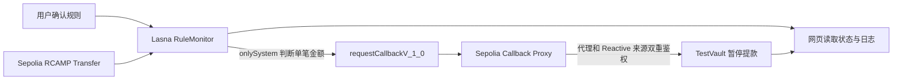

# Ruleline 产品范围与架构

## 要解决的问题

测试金库的管理者希望把一句容易理解的中文条件变成一条可核对的自动化规则，并看到执行到哪一步。本项目只演示：指定账户在 Sepolia 上单笔转出 RCAMP 达到阈值后，请求暂停本项目测试金库的提款。

转账事件先发生，系统随后反应；已经发生的转账无法被阻止。暂停只影响接入此规则的 TestVault，不影响用户钱包和其他协议。阈值达成不是盗窃或恶意行为的证明。

## 面向用户的流程

1. 输入规则和待监听账户。本地模式用固定规则匹配；可选模型可以尝试理解更自然的中文。
2. 核对账户、RCAMP 地址、金额、目标金库计划、网络、预存和 Gas，明确勾选确认。
3. 用户在钱包中逐次切换网络并确认：部署 Lasna 监听合约、部署 Sepolia 金库、绑定金库。
4. 用户从被监听的测试账户发起 Sepolia RCAMP 转账。页面读取监听合约与金库的真实状态，并提供可核对的浏览器链接。
5. 可选模型依据读取到的事实进行解释；模型可能出错，结论应以链上证据为准。

## 技术路径

- `src/RuleMonitor.sol`：按链、代币、事件签名、转出账户订阅，校验日志并比较单笔金额。首次达标且目标已绑定后，请求回调并退订。
- `src/TestVault.sol`：只接受指定 Callback Proxy 与指定 Reactive 合约的回调；暂停时拒绝 owner 提款。owner 可恢复提款，但不会重新启动监听。
- `web/`：规则编辑、核对、钱包操作、链上状态与证据。浏览器只在用户点击对应操作时向钱包发起请求。
- `server/agent.mjs`：可选模型代理。仅发送用户点击 AI 时提供的规则或状态；凭据由用户自行放在进程环境中。配置状态不等于模型连接成功。
- `test/`：通过模拟系统合约和代理验证本地行为，不代表实际跨链交付。

## 必须理解的边界

- 金库绑定前已发生的达标转账不会自动补发。
- 一次达标请求后退订；目标回调失败、欠费或延迟时没有自动重试。恢复提款也不重新订阅。
- 合约原生币余额、系统欠费和代理储备是不同概念；直接转账给金库不等于已清除代理欠费。
- 页面查询失败、日志超出 RPC 限制、回调还没记录都不能证明成功或失败。目标金库记录的源交易与监听合约匹配可作为执行状态依据；浏览器中的目标交易及事件用于进一步核验。
- 仅支持一个账户、一种代币、单笔大于等于阈值后暂停金库。不能配置累计、多代币、通知或其他协议操作。
- 测试网与黑客松演示用途，未经审计，不适合真实资产。

## 学习词汇

- **事件**：合约写入交易日志的记录，RCAMP 转账会产生 `Transfer`。
- **监听合约**：Reactive Network 收到匹配事件后调用它的 `react()`；本项目仅系统合约可调用。
- **回调代理**：目标链上负责投递回调的官方合约；目标金库必须同时核验代理和发起监听合约。
- **Gas**：测试网上执行交易的费用；数值由网络和钱包估算决定。
- **欠费**：系统或回调代理记录的待付费用；余额不足或欠费可能使执行停滞。
